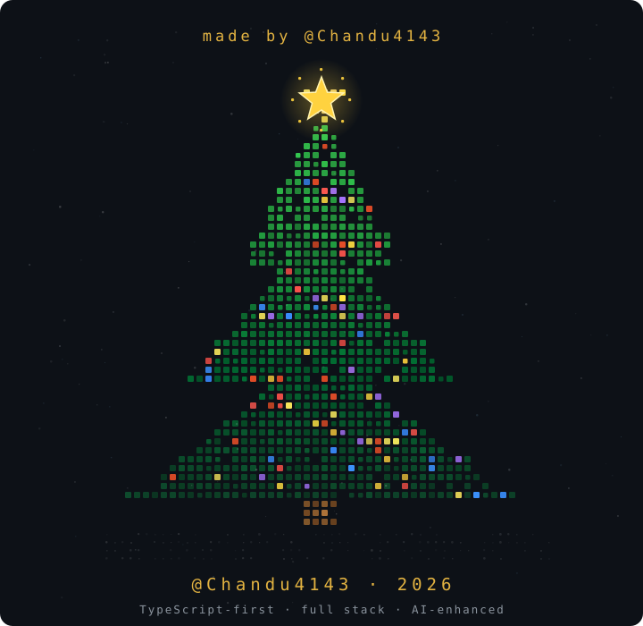

  

 

  
  
  

# About Me:

👋 Hi, I'm **Chandu** — a Full Stack Developer crafting seamless user experiences with AI.

💻 I build data-driven, user-centric web apps with a marketer's eye for engagement, and I love wiring modern full-stack stacks to **RAG**, prompt engineering, and AI workflows.

🌱 Currently deepening my TypeScript / Next.js craft while shipping projects end-to-end.

# Tech Stack:

🤖 **AI toolkit:** Claude Code · Gemini CLI · Prompt Engineering · RAG (Retrieval-Augmented Generation)

## 🌐 Socials:

---

<!-- Proudly crafted for @Chandu4143 -->
